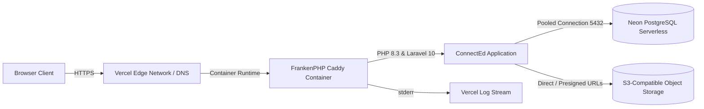

# ConnectEd Deployment & Operations Guide

This document describes the deployment architecture, configuration steps, remote database migrations, smoke-testing procedures, and temporary demo teardown for **ConnectEd** on GitHub, Vercel (FrankenPHP / Docker runtime), and Neon PostgreSQL.

---

## 1. Deployment Architecture



- **Runtime:** Containerized FrankenPHP 1.x running PHP 8.3 on Debian Bookworm via `Dockerfile.vercel` and `Caddyfile`.
- **Database:** Serverless PostgreSQL 16 hosted on Neon.
  - Runtime app instances connect using the **Neon Pooled Connection** string (`-pooler` host) to handle horizontal serverless scaling without connection exhaustion.
  - Schema migrations (`php artisan migrate`) run from a deployment runner using the **Neon Direct Connection** string.
- **Sessions & Cache:** `SESSION_DRIVER=database` and `CACHE_DRIVER=database` using PostgreSQL.
- **File Storage:** S3-compatible cloud object storage (AWS S3 / Cloudflare R2 / Supabase Storage) via Laravel's `DocumentService`.

---

## 2. Prerequisites & Human Checkpoints

As defined in the project governance rules, human operators perform the following non-delegated setup tasks:

1. **GitHub Repository:** Push the committed code and phase tags to `main` branch.
2. **Neon Database:** Retrieve connection credentials from the Neon Console:
   - Direct Host (for running migrations)
   - Pooled Host (for `DB_HOST` in runtime Vercel environment variables)
3. **Object Storage Bucket:** Create a private S3-compatible bucket and configure CORS to allow `GET` and `PUT` from your domain.
4. **Vercel Account:** Connect GitHub repository to Vercel and configure container service settings.

---

## 3. Environment Variables Reference (Vercel)

Set these environment variables in your Vercel Project Settings (`Settings -> Environment Variables`). **Never commit actual secret values into git.**

| Variable Name | Example / Recommended Value | Description |
|---|---|---|
| `APP_NAME` | `ConnectEd` | Application display name |
| `APP_ENV` | `production` | Production environment flag |
| `APP_KEY` | `base64:...` | 32-character application encryption key (`php artisan key:generate --show`) |
| `APP_DEBUG` | `false` | Disable debug stack traces |
| `APP_URL` | `https://your-app.vercel.app` | Canonical HTTPS URL |
| `APP_TIMEZONE` | `Asia/Manila` | Philippine Standard Time (PST) |
| `LOG_CHANNEL` | `stderr` | Route logs to Vercel log stream |
| `DB_CONNECTION` | `pgsql` | PostgreSQL database driver |
| `DB_HOST` | `ep-xyz-pooler.ap-southeast-1.aws.neon.tech` | **Neon Pooled Host** |
| `DB_PORT` | `5432` | PostgreSQL default port |
| `DB_DATABASE` | `neondb` | Database name |
| `DB_USERNAME` | `<neon_username>` | Database username |
| `DB_PASSWORD` | `<neon_password>` | Database password |
| `DB_SSLMODE` | `require` | Enforce SSL for Neon connections |
| `SESSION_DRIVER` | `database` | Store sessions in `sessions` table |
| `SESSION_SECURE_COOKIE`| `true` | Enforce HTTPS-only session cookies |
| `SESSION_SAME_SITE` | `lax` | CSRF cookie protection |
| `CACHE_DRIVER` | `database` | Store cache in `cache` table |
| `QUEUE_CONNECTION` | `sync` | Synchronous queue processing |
| `FILESYSTEM_DISK` | `documents` | S3-compatible storage disk |
| `AWS_ACCESS_KEY_ID` | `<bucket_key>` | Storage access key |
| `AWS_SECRET_ACCESS_KEY` | `<bucket_secret>` | Storage secret key |
| `AWS_DEFAULT_REGION` | `ap-southeast-1` | Cloud bucket region |
| `AWS_BUCKET` | `connected-bsau-documents` | Bucket name |
| `AWS_ENDPOINT` | `https://...` | S3-compatible API endpoint |
| `AWS_USE_PATH_STYLE_ENDPOINT` | `false` | Path style addressing toggle |

---

## 4. Remote Database Migration & Synthetic Seeding

Run the database schema setup once from a trusted terminal against the **Neon Direct Connection**:

```bash
# 1. Run migrations against remote Neon database
DB_HOST="ep-xyz.ap-southeast-1.aws.neon.tech" \
DB_PORT=5432 \
DB_DATABASE="neondb" \
DB_USERNAME="<neon_user>" \
DB_PASSWORD="<neon_password>" \
DB_SSLMODE=require \
php artisan migrate --force

# 2. Seed synthetic demonstration data
ALLOW_DEMO_SEED=true \
SEED_DEFAULT_PASSWORD="Password123!" \
DB_HOST="ep-xyz.ap-southeast-1.aws.neon.tech" \
DB_PORT=5432 \
DB_DATABASE="neondb" \
DB_USERNAME="<neon_user>" \
DB_PASSWORD="<neon_password>" \
DB_SSLMODE=require \
php artisan db:seed --force
```

---

## 5. Deployment Commands

Deploy preview and production versions using the Vercel CLI:

```bash
# Link project
vercel link

# Deploy preview container
vercel deploy

# Deploy to production
vercel deploy --prod
```

---

## 6. Live Smoke Test Checklist

Once deployed to the live URL, verify all 5 user roles:

1. **System Health Check:**
   - Request `GET https://your-app.vercel.app/health` &rarr; Returns `{"status":"ok"}`.
2. **OJT Coordinator (OC):**
   - Log in as `coordinator@bsau.edu.ph` / `Password123!`.
   - Verify OC Dashboard renders with "Students Without a Company" table, MOA metrics, and task feed.
   - Navigate to `/reports` and download Placements CSV.
3. **Co-Coordinator (COC):**
   - Log in as `cocoordinator@bsau.edu.ph` / `Password123!`.
   - Verify assigned student cohort, task status toggles, and pending weekly reports queue.
4. **University Attorney (UA):**
   - Log in as `attorney@bsau.edu.ph` / `Password123!`.
   - Verify Legal Console displays MOAs in `under_legal_review` status.
5. **Partner Company (PC):**
   - Log in as `partner@company.com` / `Password123!`.
   - Verify company portal shows open opportunities, active interns, and chronological applicant list (strictly adhering to Rule BR-20).
6. **ICS Student:**
   - Log in as `student@bsau.edu.ph` / `Password123!`.
   - Verify profile readiness meter, top skill match recommendations with private match score, and application pipeline.
7. **Responsive & Theme Verification:**
   - Toggle Dark/Light/System theme mode on desktop and mobile viewports.
   - Check notification bell dropdown in topbar.

---

## 7. Teardown Procedures (Temporary Demo)

When the demonstration period or evaluation is complete:

1. **Vercel Project Removal:**
   - Navigate to Vercel Project Settings &rarr; General &rarr; **Delete Project**.
   - Type project name to confirm container and domain deletion.
2. **Neon Database Teardown:**
   - Open Neon Console &rarr; Select Project / Branch &rarr; **Delete Branch** or **Delete Project**.
3. **Storage Bucket Purge:**
   - Delete all uploaded synthetic test files in the cloud storage bucket and remove the bucket.
4. **Credential Rotation:**
   - Invalidate any generated storage API keys and database user credentials.
   - Confirm that no real student or partner personal data was ever loaded.
