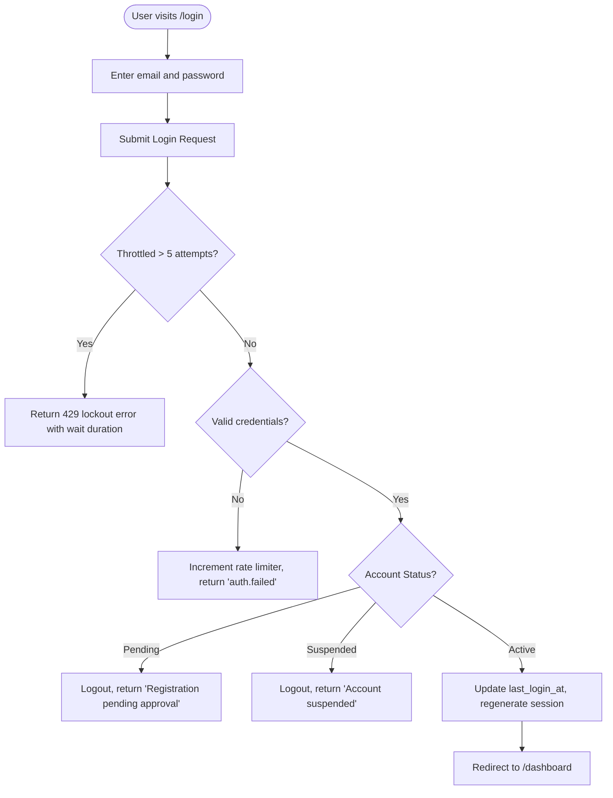

# F-001 Authentication and App Shell Foundation

| Field | Value |
|---|---|
| Feature ID | F-001 |
| Module | Authentication & App Shell Foundation |
| Status | Done |
| Phase | 1 |
| Requirements | FR-01, FR-02, NFR-01, NFR-03, NFR-07 |
| Business rules | BR-01, BR-02, BR-15 |
| Roles with access | OC, COC, UA, PC, Student (all authenticated roles) |
| Owner (code) | `app/Http/Controllers/Auth/`, `app/Models/User.php`, `resources/views/layouts/` |

## 1. Purpose
Provides secure session-based authentication, account status enforcement (blocking pending and suspended users), rate-limited login defense, and a responsive, LinkedIn-inspired application shell with role-aware navigation and a zero-FOUC three-state theme toggle (Light / Dark / System).

## 2. User flow

## 3. Screens
- `resources/views/welcome.blade.php` (`/`): Public institutional landing page with module previews and authentication entry points.
- `resources/views/auth/login.blade.php` (`/login`): Accessible sign-in card with rate-limit notices, demo account credentials, and theme toggle.
- `resources/views/layouts/app.blade.php`: Role-tailored application shell with fixed sidebar, mobile off-canvas drawer, notification bell, and user menu.
- `resources/views/dashboard.blade.php` (`/dashboard`): Role-aware dashboard displaying role badge, key metrics, and priority widgets.

## 4. Routes
| Method | URI | Route name | Controller@action | Middleware / Policy |
|---|---|---|---|---|
| GET | `/health` | `health` | Closure | None |
| GET | `/` | None | Closure | `web` |
| GET | `/login` | `login` | `AuthenticatedSessionController@create` | `guest` |
| POST | `/login` | `login` | `AuthenticatedSessionController@store` | `guest`, `LoginRequest` |
| POST | `/logout` | `logout` | `AuthenticatedSessionController@destroy` | `auth` |
| GET | `/dashboard` | `dashboard` | Closure | `auth`, `verified` |

## 5. Data
- **`users`**: `name`, `email`, `password`, `role` (`UserRole`), `status` (`UserStatus`), `must_change_password`, `approved_by`, `approved_at`, `last_login_at`, `deleted_at`.
- **`sessions`**: Database-backed sessions for ephemeral container durability.
- **`cache`**: Database-backed cache storage.
- All records use `SoftDeletes`; hard deletes are strictly forbidden.

## 6. Rules and validation
- Login is throttled to 5 attempts per minute per `email|IP`.
- Users with `status = 'pending'` or `status = 'suspended'` are rejected with clear, non-leaky messages.
- Password minimum length 10 in production.
- Enums validated using PHP 8.3 backed enums: `UserRole` and `UserStatus`.

## 7. Notifications and audit
- Login rate-limiting dispatches `Illuminate\Auth\Events\Lockout`.
- Successful logins update `users.last_login_at`.

## 8. Edge cases and errors
- **Theme flashing (FOUC):** Eliminated via inline blocking script in `<head>` inspecting `localStorage` before paint.
- **Pending student login attempt:** Safely logged out, rate limit incremented, generic pending approval notice displayed.
- **Mobile layout:** Sidebar transforms into an off-canvas drawer controlled via Alpine.js with zero horizontal scroll.

## 9. Tests
- `tests/Feature/HealthCheckTest.php`:
  - `test_health_check_returns_ok_status_without_db_dependency`
- `tests/Feature/Auth/AuthenticationTest.php`:
  - `test_login_screen_can_be_rendered`
  - `test_active_users_can_authenticate_using_the_login_screen`
  - `test_users_can_not_authenticate_with_invalid_password`
  - `test_pending_users_are_blocked_from_logging_in`
  - `test_suspended_users_are_blocked_from_logging_in`
  - `test_login_is_throttled_after_five_failed_attempts`
  - `test_users_can_logout`
- `tests/Feature/ThemePreferenceTest.php`:
  - `test_guest_pages_render_blocking_theme_script_and_toggle`
  - `test_authenticated_pages_render_blocking_theme_script_and_toggle`

Command: `php artisan test`

## 10. Known limitations and assumptions
- Password resets via self-service email are disabled (A8); coordinator password resets will be fully implemented in Phase 2.
- Session and cache drivers rely on PostgreSQL tables, required for Vercel deployment.

## 11. Change history
| Date | Change | Commit |
|---|---|---|
| 2026-10-16 | Initial implementation of authentication, role enums, and app shell | `feat(auth): initialize authentication and app shell foundation` |
