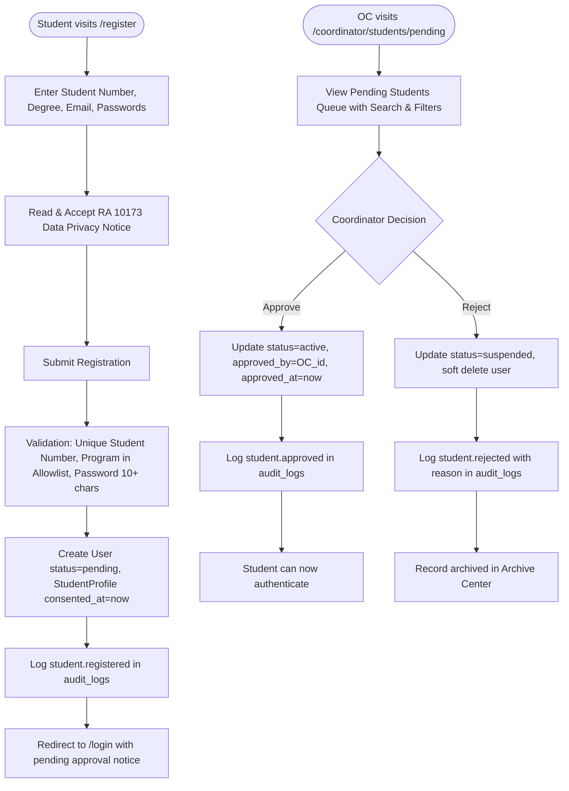

# F-002 Student Self-Registration and Coordinator Approval

| Field | Value |
|---|---|
| Feature ID | F-002 |
| Module | Student Lifecycle & Identity |
| Status | Done |
| Phase | 2 |
| Requirements | FR-01, FR-02, NFR-01, NFR-03, NFR-07 |
| Business rules | BR-01, BR-02, BR-15, BR-20 |
| Roles with access | Guest (register), OC (review, approve, reject), Student (view own pending state) |
| Owner (code) | `app/Http/Controllers/Auth/RegisteredUserController.php`, `app/Http/Controllers/Coordinator/StudentApprovalController.php`, `app/Models/StudentProfile.php` |

## 1. Purpose
Allows ICS students to self-register by providing their student number, academic degree program, section, and explicit Data Privacy Act of 2012 (RA 10173) consent. The account enters an unauthenticated `pending` status until verified and approved by the OJT Coordinator (OC). Rejections soft-delete the record into the Archive with an audited reason.

## 2. User flow

## 3. Screens
- `resources/views/auth/register.blade.php` (`/register`): Student self-registration form with RA 10173 modal dialog.
- `resources/views/coordinator/students/pending.blade.php` (`/coordinator/students/pending`): Coordinator approval queue with search by student name/number/email, program dropdown filter, instant one-click approval, and reason-prompt rejection modal.

## 4. Routes
| Method | URI | Route name | Controller@action | Middleware / Policy |
|---|---|---|---|---|
| GET | `/register` | `register` | `RegisteredUserController@create` | `guest` |
| POST | `/register` | None | `RegisteredUserController@store` | `guest` |
| GET | `/coordinator/students/pending` | `coordinator.students.pending` | `StudentApprovalController@index` | `auth`, `verified`, `can:approve,App\Models\User` |
| POST | `/coordinator/students/{user}/approve` | `coordinator.students.approve` | `StudentApprovalController@approve` | `auth`, `verified`, `can:approve,App\Models\User` |
| POST | `/coordinator/students/{user}/reject` | `coordinator.students.reject` | `StudentApprovalController@reject` | `auth`, `verified`, `can:approve,App\Models\User` |

## 5. Data
- **`users`**: Role set to `student`, status set to `pending`. On approval: status updated to `active`, `approved_by` populated with OC user ID, `approved_at` set to timestamp.
- **`student_profiles`**: Linked via `user_id`, stores `student_number`, `program`, `year_level`, `section`, `school_year`, `consented_at`, `privacy_notice_version`.
- **`audit_logs`**: Permanent records written for `student.registered`, `student.approved`, and `student.rejected`.

## 6. Rules and validation
- Student number must be unique across all `student_profiles`.
- Program must exist in `config('connected.allowed_programs')` (default: `['BSIT']`).
- Passwords require minimum 10 characters with mixed-case and numeric complexity.
- Data privacy consent (`privacy_consent`) is mandatory; submission fails without acceptance.
- Pending students attempting login are blocked with an explicit, non-leaky warning before authentication is established.
- Rejection performs soft deletion (`deleted_at`), transitioning status to `suspended`, preserving full traceability.

## 7. Security and authorization
- Handled through `UserPolicy@approve` which restricts student queue management strictly to OJT Coordinators (`UserRole::OC`).
- All approval and rejection operations are protected against CSRF attacks.

## 8. Failure modes
- **Duplicate Student Number:** Returns validation error `The student number has already been taken.`
- **Invalid Program:** Returns validation error `The selected program is invalid.`
- **Unverified Login Attempt:** Controller blocks login attempt, returning `Your student account is pending coordinator approval.`

## 9. Testing
- Automated test coverage in `tests/Feature/Auth/RegistrationTest.php` and `tests/Feature/Coordinator/StudentRegistrationApprovalTest.php`.
- Verified pending status assignment, DPA notice rendering, approval and rejection actions, and audit log generation.
