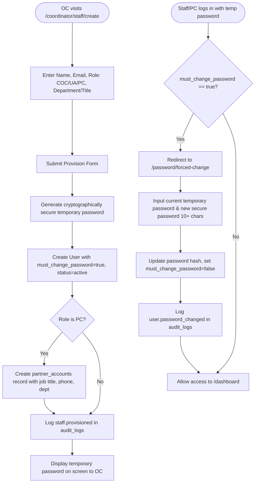

# F-003 Staff Provisioning and Password Management

| Field | Value |
|---|---|
| Feature ID | F-003 |
| Module | Institutional RBAC & Access Control |
| Status | Done |
| Phase | 2 |
| Requirements | FR-01, FR-02, NFR-01, NFR-03, NFR-07 |
| Business rules | BR-01, BR-02, BR-15 |
| Roles with access | OC (provision and reset), All Staff (COC, UA, PC - forced password change) |
| Owner (code) | `app/Http/Controllers/Coordinator/StaffProvisioningController.php`, `app/Http/Controllers/Coordinator/PasswordResetController.php`, `app/Http/Controllers/Auth/ForcedPasswordChangeController.php`, `app/Http/Middleware/EnsurePasswordIsChanged.php` |

## 1. Purpose
Empowers the OJT Coordinator (OC) to provision internal faculty/staff (Co-OJT Coordinator, University Attorney) and external Partner Company representatives without open self-registration. Enforces first-login credential rotation via `EnsurePasswordIsChanged` middleware and provides administrative password reset capabilities with full audit trails.

## 2. User flow

## 3. Screens
- `resources/views/coordinator/staff/index.blade.php` (`/coordinator/staff`): Staff accounts directory showing name, role badge, email, status, and reset password triggers.
- `resources/views/coordinator/staff/create.blade.php` (`/coordinator/staff/create`): Account provisioning form with role selection and optional partner profile fields.
- `resources/views/auth/forced-password-change.blade.php` (`/password/forced-change`): Enforced password change interface with policy requirements display.

## 4. Routes
| Method | URI | Route name | Controller@action | Middleware / Policy |
|---|---|---|---|---|
| GET | `/coordinator/staff` | `coordinator.staff.index` | `StaffProvisioningController@index` | `auth`, `verified`, `can:provisionStaff,App\Models\User` |
| GET | `/coordinator/staff/create` | `coordinator.staff.create` | `StaffProvisioningController@create` | `auth`, `verified`, `can:provisionStaff,App\Models\User` |
| POST | `/coordinator/staff` | `coordinator.staff.store` | `StaffProvisioningController@store` | `auth`, `verified`, `can:provisionStaff,App\Models\User` |
| POST | `/coordinator/users/{user}/reset-password` | `coordinator.users.reset-password` | `PasswordResetController@reset` | `auth`, `verified`, `can:resetPassword,App\Models\User` |
| GET | `/password/forced-change` | `password.forced-change` | `ForcedPasswordChangeController@show` | `auth` |
| POST | `/password/forced-change` | `password.forced-update` | `ForcedPasswordChangeController@update` | `auth` |

## 5. Data
- **`users`**: Fields `role`, `status`, `must_change_password`, `approved_by`, `approved_at`.
- **`partner_accounts`**: Associated with `users.id` for PC role, storing `department`, `job_title`, `phone_number`.
- **`audit_logs`**: Permanent audit entries for `staff.provisioned`, `user.password_reset`, and `user.password_changed`.

## 6. Rules and validation
- Only the OC role is authorized to provision accounts or initiate administrative password resets (BR-01, BR-02).
- Students cannot be provisioned via staff management; attempts return validation errors directing them to student registration.
- Any user with `must_change_password = true` is intercepted on every authenticated route by `EnsurePasswordIsChanged` middleware and redirected to `/password/forced-change`.
- New passwords must meet the BSAU security policy: minimum 10 characters, mixed uppercase/lowercase, and numeric characters.

## 7. Security and authorization
- Enforced server-side via `UserPolicy@provisionStaff` and `UserPolicy@resetPassword`.
- Password change requires verifying the user's current temporary password before accepting the new hash.

## 8. Failure modes
- **Student Role Submission:** Rejected with error session message.
- **Mismatched Current Password on Reset:** Throws validation error `The provided password does not match your current password.`

## 9. Testing
- Covered in `tests/Feature/Coordinator/StaffProvisioningTest.php` and `tests/Feature/Auth/ForcedPasswordChangeTest.php`.
- Verified staff creation, partner account association, middleware redirection, password update, and audit recording.
