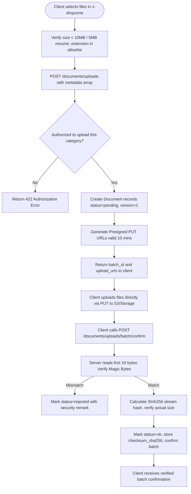

# F-004 Document Service and Presigned Direct Storage

| Field | Value |
|---|---|
| Feature ID | F-004 |
| Module | Document Management & Verification |
| Status | Done |
| Phase | 2 |
| Requirements | FR-04, FR-05, FR-06, FR-15, NFR-03, NFR-04 |
| Business rules | BR-04, BR-05, BR-06, BR-15 |
| Roles with access | OC, COC, UA, PC, Student (scoped by authorization matrix) |
| Owner (code) | `app/Services/DocumentService.php`, `app/Http/Controllers/DocumentController.php`, `app/Policies/DocumentPolicy.php`, `resources/views/components/dropzone.blade.php` |

## 1. Purpose
Provides a secure direct-to-storage document architecture eliminating server memory exhaustion from large uploads. Supports presigned S3/R2 direct uploads in production and signed local route fallbacks in local development. Enforces strict magic-byte file signature inspection, SHA256 checksum integrity, size limits, and a role-based document access matrix.

## 2. User flow

## 3. Screens & Components
- `resources/views/components/dropzone.blade.php`: Reusable Alpine.js drag-and-drop file upload component with real-time progress bar, direct PUT upload engine, and auto-batch confirmation.
- Document links throughout the app route to `/documents/{document}/download`.

## 4. Routes
| Method | URI | Route name | Controller@action | Middleware / Policy |
|---|---|---|---|---|
| POST | `/documents/uploads` | `documents.slots` | `DocumentController@requestSlots` | `auth` |
| POST | `/documents/uploads/{batch}/confirm` | `documents.confirm` | `DocumentController@confirmBatch` | `auth` |
| GET | `/documents/{document}/download` | `documents.download` | `DocumentController@download` | `auth`, `can:download,document` |
| PUT | `/documents/upload/direct` | `documents.upload.direct` | `DocumentController@directUpload` | `signed` (Local Dev) |
| GET | `/documents/{document}/serve` | `documents.download.serve` | `DocumentController@directDownloadServe` | `signed` (Local Dev) |

## 5. Data
- **`documents`**: `owner_user_id`, `category`, `original_name`, `storage_key`, `stored_path`, `disk`, `mime_type`, `size_bytes`, `checksum_sha256`, `validation_status` (`pending`, `ok`, `rejected`), `version_no`, `is_current`, `review_status`, `uploaded_by`, `upload_batch_id`, `school_year`.
- **`document_batches`**: `user_id`, `status` (`pending`, `confirmed`), `file_count`, `confirmed_at`.
- All document records use `SoftDeletes`.

## 6. Rules and validation
- Maximum file sizes: Resumes capped at 5MB (`config('connected.max_resume_size_mb')`); all other documents capped at 10MB (`config('connected.max_file_size_mb')`).
- File extension allowlist: `.pdf`, `.docx`, `.png`, `.jpg`, `.jpeg`.
- Magic byte inspection:
  - PDF: `%PDF` (`\x25\x50\x44\x46`)
  - PNG: `\x89PNG\r\n\x1a\n` (`\x89\x50\x4E\x47\x0D\x0A\x1A\x0A`)
  - JPG/JPEG: `\xFF\xD8\xFF`
  - DOCX: `PK..` (`\x50\x4B\x03\x04` zip container)
- Renamed executable files or mismatched payloads are rejected during confirmation.
- Direct downloads generate temporary presigned URLs valid for 60 seconds with strict `nosniff` headers. Non-owner downloads write an immutable audit log entry.

## 7. Security and authorization matrix
- Enforced via `DocumentPolicy` and `DocumentService`:
  - **OC**: Full upload and download access across all categories.
  - **Student**: May only upload `resume`, `certification`, `weekly_report` for themselves; may download only their own documents (plus public templates).
  - **COC**: May view and download documents of students assigned to their cohort.
  - **UA**: May review and download `moa` documents across all companies and students.
  - **PC**: May upload company verification documents and download applicant resumes.

## 8. Failure modes
- **Disallowed Extension:** 422 Unprocessable Entity during slot request.
- **Mismatched Magic Bytes:** Status marked `rejected`, download blocked.
- **Unauthorized Download Attempt:** 403 Forbidden.

## 9. Testing
- Covered in `tests/Feature/Documents/DocumentAuthorizationMatrixTest.php` and `tests/Feature/Documents/FileValidationTest.php`.
- Verified authorization matrix permissions, magic-byte inspection, SHA256 checksum calculation, and signed download delivery.
