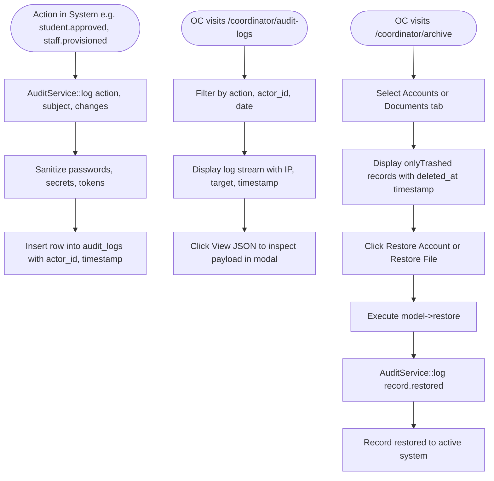

# F-005 Global Archive Center and Immutable Audit Trail

| Field | Value |
|---|---|
| Feature ID | F-005 |
| Module | Compliance, Audit & Archiving |
| Status | Done |
| Phase | 2 |
| Requirements | FR-15, FR-16, NFR-03, NFR-07 |
| Business rules | BR-15 |
| Roles with access | OC (exclusive access to archive management and audit viewer) |
| Owner (code) | `app/Http/Controllers/Coordinator/ArchiveController.php`, `app/Http/Controllers/Coordinator/AuditLogController.php`, `app/Services/AuditService.php`, `app/Models/AuditLog.php` |

## 1. Purpose
Provides compliance guarantees for BSAU academic auditing. Enforces soft deletes across all business models with a dedicated Archive Center where soft-deleted records can be inspected and restored by the OJT Coordinator. Maintains a strictly append-only, immutable `audit_logs` table that records all lifecycle events, administrative decisions, and sensitive data accesses.

## 2. User flow

## 3. Screens
- `resources/views/coordinator/archive/index.blade.php` (`/coordinator/archive`): Archive browser featuring tabbed pill navigation (Archived Accounts vs Archived Documents), deletion metadata, and confirmation restore triggers.
- `resources/views/coordinator/audit-logs/index.blade.php` (`/coordinator/audit-logs`): Audit trail viewer with multi-criteria search (action pattern, log date, actor user ID) and Alpine.js interactive JSON context modal.

## 4. Routes
| Method | URI | Route name | Controller@action | Middleware / Policy |
|---|---|---|---|---|
| GET | `/coordinator/archive` | `coordinator.archive.index` | `ArchiveController@index` | `auth`, `verified`, `can:viewAny,App\Models\User` |
| POST | `/coordinator/archive/{type}/{id}/restore` | `coordinator.archive.restore` | `ArchiveController@restore` | `auth`, `verified`, `can:viewAny,App\Models\User` |
| GET | `/coordinator/audit-logs` | `coordinator.audit-logs.index` | `AuditLogController@index` | `auth`, `verified`, `can:viewAny,App\Models\User` |

## 5. Data
- **`audit_logs`**: Strictly append-only table without soft deletes. Schema: `actor_id`, `action`, `subject_type`, `subject_id`, `changes` (JSONB), `ip_address`, `created_at`.
- Protected at model boot level: `updating` and `deleting` Eloquent events throw a `\RuntimeException`.

## 6. Rules and validation
- Hard deletes (`forceDelete()`) are strictly forbidden across the entire application (BR-15).
- All sensitive operations record an audit event.
- Passwords, verification codes, remember tokens, and security secrets are automatically stripped by `AuditService::sanitizeChanges`.
- Non-coordinator users attempting to view or restore archived records are blocked with 403 Forbidden.

## 7. Security and authorization
- Guarded by `UserPolicy@viewAny`, which restricts access strictly to OJT Coordinators (`UserRole::OC`).
- Database constraints prevent modifying or deleting historical audit entries.

## 8. Failure modes
- **Attempt to Modify Audit Log:** Application throws `\RuntimeException: Audit log records are append-only and cannot be updated.`
- **Attempt to Delete Audit Log:** Application throws `\RuntimeException: Audit log records are immutable and cannot be deleted.`
- **Non-OC Access:** Returns HTTP 403 Forbidden.

## 9. Testing
- Covered in `tests/Feature/Audit/AuditLogTest.php` and `tests/Feature/Coordinator/ArchiveRestoreTest.php`.
- Verified append-only immutability exceptions, log entry generation, search filtering, user restoration, document restoration, and role authorization guards.
