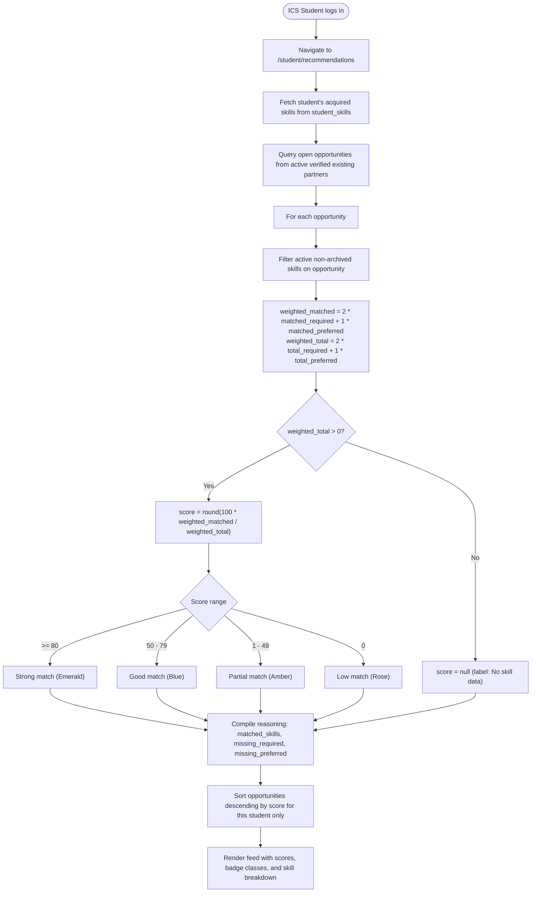

# F-013 Transparent Skill-Based Recommendation Engine

| Field | Value |
|---|---|
| Feature ID | F-013 |
| Module | Matching & Recommendations |
| Status | Done |
| Phase | 5 |
| Requirements | FR-10, FR-11, NFR-01, NFR-03, NFR-04, NFR-06, NFR-07 |
| Business rules | BR-20 |
| Roles with access | Student (view personal recommendations with calculated scores & reasoning breakdown); all other roles strictly forbidden from viewing scores or ranking students |
| Owner (code) | `app/Services/SkillMatcher.php`, `app/Http/Controllers/Student/RecommendationController.php`, `resources/views/student/recommendations/index.blade.php` |

## 1. Purpose
Provides a transparent, deterministic, rule-based recommendation engine that evaluates open internship opportunities against an ICS student's acquired technical skills. Eliminates black-box ML algorithms in favor of a formula where required skills carry 2x weight and preferred skills carry 1x weight. Enforces **Rule BR-20 (Confidentiality & Non-Ranking of Students)**: match scores and rankings are calculated on the fly and visible *strictly and exclusively to the student concerned*. The system recommends opportunities to students, but *never ranks or sorts student applicants for companies or coordinators*.

## 2. User flow & Formula

## 3. Screens
- `resources/views/student/recommendations/index.blade.php` (`/student/recommendations`):
  - Institutional Rule BR-20 privacy disclaimer card emphasizing that scores are never exposed to employers or coordinators.
  - Multi-criteria filter bar: search query, match tier filter (`Strong match`, `Good match`, `Partial match`, `Low match`), work arrangement, and partner organization.
  - Recommendation cards displaying:
    - Opportunity title, verified partner badge, work arrangement, and logistics.
    - Prominent Match Score Card with percentage score and color-coded status badge.
    - Transparent reasoning breakdown:
      - **Matched Skills**: Acquired competencies meeting posting requirements.
      - **Missing Required**: Deficits in critical prerequisites (2x impact).
      - **Missing Preferred**: Optional competencies not yet acquired (1x impact).
    - Quick CTA button linking to complete role profile.

## 4. Routes
| Method | URI | Route name | Controller@action | Middleware / Policy |
|---|---|---|---|---|
| GET | `/student/recommendations` | `student.recommendations.index` | `Student\RecommendationController@index` | `auth`, `verified` (Student role only) |

## 5. Data
- Pure service execution via `App\Services\SkillMatcher`:
  - No cached or persisted match scores in the database.
  - Dynamic evaluation prevents stale recommendations when students add skills or opportunities update requirements.
  - Ignores archived, inactive, or pending skills.

## 6. Rules and validation
- **Rule BR-20 (Non-Ranking of Students):**
  - Match scores are visible **only** to the student viewing their own recommendations.
  - The recommendations route strictly checks `$user->isStudent()` and aborts HTTP 403 Forbidden for all other roles (OC, COC, UA, PC).
  - Match scores are never included in applicant lists, never displayed on coordinator or company dashboards, and never used in an `ORDER BY` clause for any student list.
- **Formula:**
  $$\text{weighted\_matched} = 2 \times \text{matched\_required} + 1 \times \text{matched\_preferred}$$
  $$\text{weighted\_total} = 2 \times \text{total\_required} + 1 \times \text{total\_preferred}$$
  $$\text{score} = \text{round}\left(100 \times \frac{\text{weighted\_matched}}{\text{weighted\_total}}\right)$$
  - Returns `null` ("No skill data") if $\text{weighted\_total} = 0$.

## 7. Testing
- `tests/Unit/Services/SkillMatcherTest.php`:
  - `test_all_skills_matched_gives_100_percent_strong_match`
  - `test_none_matched_gives_0_percent_low_match`
  - `test_only_preferred_matched`
  - `test_no_required_skills_only_preferred`
  - `test_no_skills_at_all_on_opportunity_returns_null_score`
  - `test_duplicate_skill_ids_in_student_input_are_deduplicated`
  - `test_inactive_and_archived_skills_are_ignored`
- `tests/Feature/Student/RecommendationTest.php`:
  - `test_student_sees_accurate_match_score_and_reasoning_breakdown`
  - `test_rule_br20_recommendations_route_is_strictly_forbidden_to_non_students`
  - `test_rule_br20_no_controller_or_query_ranks_or_sorts_students_by_match_score`
