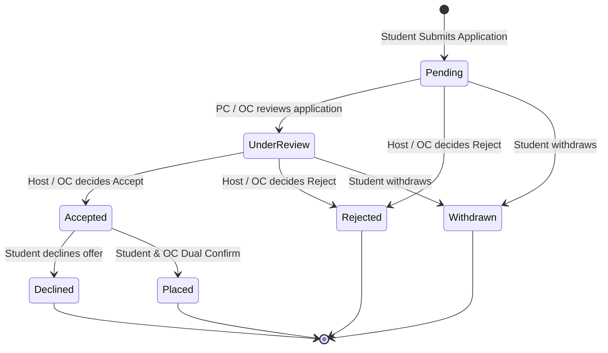

# F-014 Application Workflow & Coordinator Decisions

| Field | Value |
|---|---|
| Feature ID | F-014 |
| Module | Applications |
| Status | Done |
| Phase | 6 |
| Requirements | FR-12, FR-13, NFR-01, NFR-03, NFR-04, NFR-06, NFR-07 |
| Business rules | BR-19, BR-20 |
| Roles with access | Student (apply, view own applications, withdraw, confirm/decline offers), Partner Company (review applicants, mark under review, decide accept/reject with remarks), OC / COC (view all applications, review applicants, endorse/accept/reject applications) |
| Owner (code) | `app/Http/Controllers/Student/StudentApplicationController.php`, `app/Http/Controllers/Coordinator/CoordinatorApplicationController.php`, `app/Http/Controllers/PartnerCompany/CompanyApplicationController.php`, `app/Services/PlacementService.php` |

## 1. Purpose
Empowers ICS students to apply for verified OJT opportunities with their verified skills profile and an optional cover note / expression of interest. Enables partner companies to evaluate applicants transparently without automated ranking or filtering (upholding **Rule BR-20**). Coordinates decisions between host companies and the OJT Coordinator (OC), maintaining complete audit logs and in-system status tracking across every stage of the application lifecycle.

## 2. User Flow & State Machine

## 3. Screens
- `resources/views/student/applications/index.blade.php` (`/student/applications`):
  - Student application dashboard showing submitted applications, status badges, company details, submission timestamps, and quick action buttons.
  - Active placement banner when placement is confirmed or ongoing.
- `resources/views/student/applications/show.blade.php` (`/student/applications/{id}`):
  - Application detail page displaying full job specifications, cover note, audit timeline logs, and offer acceptance/decline controls when offer is extended.
- `resources/views/coordinator/applications/index.blade.php` (`/coordinator/applications`):
  - Central applications management queue with multi-criteria filtering (status, company, search query).
  - List strictly ordered chronologically by submission date (Rule BR-20 non-ranking guarantee).
- `resources/views/coordinator/applications/show.blade.php` (`/coordinator/applications/{id}`):
  - Comprehensive applicant inspection view: student profile, verified skills, official resume download link, company feedback remarks, status audit logs, and coordinator action panel (Mark Under Review, Accept, Reject).
- `resources/views/company/applications/index.blade.php` (`/company/applications`):
  - Host company applicants queue filtered by posted opportunity and status.
  - Ordered chronologically by submission date without applicant ranking scores (Rule BR-20).
- `resources/views/company/applications/show.blade.php` (`/company/applications/{id}`):
  - Company review portal with student qualifications, skills overview, resume preview, and decision modal (Mark Under Review, Accept, Reject with feedback remark).

## 4. Routes
| Method | URI | Route name | Controller@action | Middleware / Policy |
|---|---|---|---|---|
| GET | `/student/applications` | `student.applications.index` | `Student\StudentApplicationController@index` | `auth`, `verified` |
| POST | `/student/opportunities/{opportunity}/apply` | `student.opportunities.apply` | `Student\StudentApplicationController@store` | `auth`, `verified` |
| GET | `/student/applications/{application}` | `student.applications.show` | `Student\StudentApplicationController@show` | `auth`, `verified` |
| POST | `/student/applications/{application}/confirm` | `student.applications.confirm` | `Student\StudentApplicationController@confirm` | `auth`, `verified` |
| POST | `/student/applications/{application}/decline` | `student.applications.decline` | `Student\StudentApplicationController@decline` | `auth`, `verified` |
| POST | `/student/applications/{application}/withdraw` | `student.applications.withdraw` | `Student\StudentApplicationController@withdraw` | `auth`, `verified` |
| GET | `/coordinator/applications` | `coordinator.applications.index` | `Coordinator\CoordinatorApplicationController@index` | `auth`, `role:oc,coc` |
| GET | `/coordinator/applications/{application}` | `coordinator.applications.show` | `Coordinator\CoordinatorApplicationController@show` | `auth`, `role:oc,coc` |
| POST | `/coordinator/applications/{application}/under-review` | `coordinator.applications.under-review` | `Coordinator\CoordinatorApplicationController@markUnderReview` | `auth`, `role:oc,coc` |
| POST | `/coordinator/applications/{application}/decide` | `coordinator.applications.decide` | `Coordinator\CoordinatorApplicationController@decide` | `auth`, `role:oc,coc` |
| GET | `/company/applications` | `company.applications.index` | `PartnerCompany\CompanyApplicationController@index` | `auth`, `role:pc` |
| GET | `/company/applications/{application}` | `company.applications.show` | `PartnerCompany\CompanyApplicationController@show` | `auth`, `role:pc` |
| POST | `/company/applications/{application}/under-review` | `company.applications.under-review` | `PartnerCompany\CompanyApplicationController@markUnderReview` | `auth`, `role:pc` |
| POST | `/company/applications/{application}/decide` | `company.applications.decide` | `PartnerCompany\CompanyApplicationController@decide` | `auth`, `role:pc` |

## 5. Data & Schema
- Table `applications`:
  - `id` (bigint, PK)
  - `student_profile_id` (foreignId -> `student_profiles`, restrictOnDelete)
  - `opportunity_id` (foreignId -> `opportunities`, restrictOnDelete)
  - `status` (string enum: `pending`, `under_review`, `accepted`, `rejected`, `withdrawn`, `declined`, `placed`)
  - `cover_note` (text, nullable)
  - `submitted_at` (timestamp)
  - `decided_by` (foreignId -> `users`, nullable)
  - `decided_at` (timestamp, nullable)
  - `decision_remark` (text, nullable)
  - `student_confirmed_at` (timestamp, nullable)
  - `oc_confirmed_at` (timestamp, nullable)
  - `school_year` (string, default '2026-2027')
  - `timestamps`, `softDeletes`
  - Partial unique index: `applications_student_opp_unique` on `(student_profile_id, opportunity_id)` WHERE `deleted_at IS NULL` (prevents duplicate applications for the same opportunity).
- Table `application_status_logs`:
  - `id` (bigint, PK)
  - `application_id` (foreignId -> `applications`, cascadeOnDelete)
  - `from_status` (string, nullable)
  - `to_status` (string)
  - `actor_id` (foreignId -> `users`, nullable)
  - `remark` (text, nullable)
  - `created_at` (timestamp)

## 6. Rules & Validation
- **BR-19 (Single Active Placement):** Students with an active placement (`has_active_placement = true`) cannot submit new applications. Attempting to submit returns a 422 / domain exception.
- **BR-20 (Non-Ranking of Students):** Coordinators and partner company reviewers see applications ordered strictly by `submitted_at DESC`. No match scores, ratings, or rank numbers are rendered on company or coordinator views.
- **Audit Logging:** Every state transition (`pending` -> `under_review` -> `accepted` / `rejected` -> `placed` / `withdrawn` / `declined`) records an immutable row in `application_status_logs` and an entry in `audit_logs`.
- **In-System Notifications:** Submission, review status updates, and formal decisions trigger database notifications to the affected student and coordinator.

## 7. Testing
- `tests/Feature/Applications/ApplicationSubmissionTest.php`:
  - `test_student_can_apply_for_open_opportunity`
  - `test_student_cannot_apply_twice_for_same_opportunity`
  - `test_student_with_active_placement_cannot_apply_br19`
  - `test_student_can_withdraw_pending_application`
  - `test_student_can_decline_accepted_offer`
  - `test_non_student_cannot_submit_application`
  - `test_company_and_coordinator_view_applicants_without_rank_scores_br20`
  - `test_coordinator_and_company_can_mark_under_review_and_decide`
