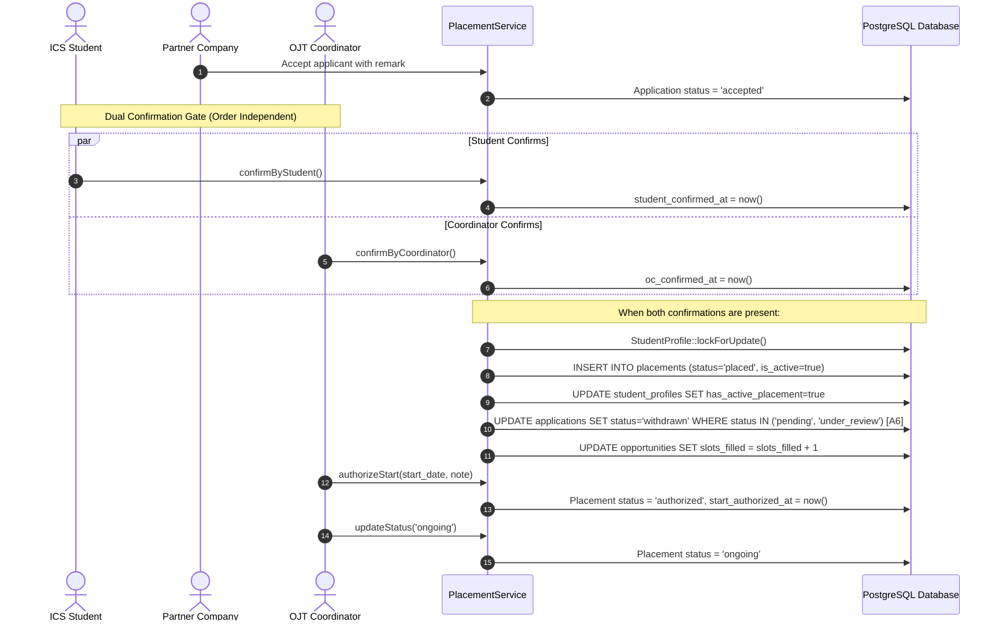

# F-015 Student Offer Confirmation & Placement Finalization

| Field | Value |
|---|---|
| Feature ID | F-015 |
| Module | Placements |
| Status | Done |
| Phase | 6 |
| Requirements | FR-14, FR-15, NFR-01, NFR-03, NFR-04, NFR-06, NFR-07 |
| Business rules | BR-19 |
| Roles with access | Student (confirm accepted offer), OC (endorse/confirm placement, authorize start, progress lifecycle), COC (view placed interns, review status), PC (view active interns) |
| Owner (code) | `app/Services/PlacementService.php`, `app/Http/Controllers/Coordinator/PlacementController.php`, `app/Http/Controllers/Student/StudentPlacementController.php`, `app/Http/Controllers/PartnerCompany/CompanyPlacementController.php` |

## 1. Purpose
Enforces the formal dual-confirmation protocol required to transform an accepted internship application into an active institutional placement. Implements **Rule BR-19 (Single Active Placement Concurrency & Integrity Check)** and **Assumption A6 (Placement Finalization Auto-Withdrawal)**, guaranteeing that when a student's placement is finalized:
1. Concurrency is strictly guarded via row-level pessimistic locking (`lockForUpdate()`) and a database partial unique index.
2. The student's `has_active_placement` flag is marked `true`.
3. All other open or pending applications for that student are automatically withdrawn with system note `"Placement finalized"`.
4. The opportunity's `slots_filled` is incremented, automatically closing the opportunity if total capacity is reached.
5. The placement enters `placed` status awaiting coordinator start authorization (`authorized` -> `ongoing` -> `completed` / `terminated`).

## 2. Dual Confirmation & Placement Lifecycle

## 3. Screens
- `resources/views/coordinator/placements/index.blade.php` (`/coordinator/placements`):
  - Coordinator placement monitoring dashboard with metrics (Active Interns, Awaiting Authorization, Completed, Terminated).
  - Search and filter bar (status, partner company, academic year).
- `resources/views/coordinator/placements/show.blade.php` (`/coordinator/placements/{id}`):
  - Detailed placement profile: student credentials, host company supervisor, start authorization letter panel, status update actions, and weekly report review table.
- `resources/views/student/placements/show.blade.php` (`/student/placements/{id}`):
  - Student placement monitoring hub: host company details, official placement status banner, start date, authorized coordinator note, and weekly accomplishment report submission form.
- `resources/views/company/placements/index.blade.php` (`/company/placements`):
  - Host company directory of placed interns, start dates, and contact information.

## 4. Routes
| Method | URI | Route name | Controller@action | Middleware / Policy |
|---|---|---|---|---|
| GET | `/student/placements/{placement}` | `student.placements.show` | `Student\StudentPlacementController@show` | `auth`, `verified` |
| GET | `/coordinator/placements` | `coordinator.placements.index` | `Coordinator\PlacementController@index` | `auth`, `role:oc,coc` |
| GET | `/coordinator/placements/{placement}` | `coordinator.placements.show` | `Coordinator\PlacementController@show` | `auth`, `role:oc,coc` |
| POST | `/coordinator/placements/{placement}/authorize-start` | `coordinator.placements.authorize-start` | `Coordinator\PlacementController@authorizeStart` | `auth`, `role:oc,coc` |
| POST | `/coordinator/placements/{placement}/status` | `coordinator.placements.status` | `Coordinator\PlacementController@updateStatus` | `auth`, `role:oc,coc` |
| GET | `/company/placements` | `company.placements.index` | `PartnerCompany\CompanyPlacementController@index` | `auth`, `role:pc` |

## 5. Data & Schema
- Table `placements`:
  - `id` (bigint, PK)
  - `student_profile_id` (foreignId -> `student_profiles`, restrictOnDelete)
  - `opportunity_id` (foreignId -> `opportunities`, restrictOnDelete)
  - `company_id` (foreignId -> `companies`, restrictOnDelete)
  - `application_id` (foreignId -> `applications`, restrictOnDelete)
  - `status` (string enum: `placed`, `authorized`, `ongoing`, `completed`, `terminated`)
  - `is_active` (boolean, default true)
  - `start_date` (date, nullable)
  - `end_date` (date, nullable)
  - `start_authorized_at` (timestamp, nullable)
  - `start_authorization_note` (text, nullable)
  - `confirmed_by` (foreignId -> `users`, nullable)
  - `school_year` (string, default '2026-2027')
  - `timestamps`, `softDeletes`
  - Partial unique index: `CREATE UNIQUE INDEX placements_student_active_unique ON placements (student_profile_id) WHERE is_active = true AND deleted_at IS NULL;`

## 6. Rules & Validation
- **Rule BR-19 (Single Active Placement):**
  - No student may have more than one placement with `is_active = true`.
  - Concurrency protected by pessimistic row-level locking on `student_profiles` inside `PlacementService::finalizePlacement()`.
  - Database-level partial unique index guarantees constraint integrity even under concurrent HTTP requests.
- **Assumption A6 (Auto-Withdrawal):**
  - When a placement is finalized, all other open applications (`pending`, `under_review`) for the student are immediately updated to `status = 'withdrawn'` with `decision_remark = 'System auto-withdrawn: Student finalized placement for opportunity #[id]'`.
- **Start Authorization Gate:**
  - Placements cannot proceed to `ongoing` without formal start authorization recorded by the OJT Coordinator (`start_authorized_at` and `start_authorization_note`).
- **Audit Logging:** Every placement creation, start authorization, and status progression is logged in `audit_logs`.

## 7. Testing
- `tests/Feature/Placements/PlacementConfirmationTest.php`:
  - `test_dual_confirmation_finalizes_placement_when_student_confirms_after_coordinator`
  - `test_dual_confirmation_finalizes_placement_when_coordinator_confirms_after_student`
  - `test_rule_br19_single_active_placement_concurrency_and_integrity_check`
  - `test_opportunity_status_changes_to_filled_when_capacity_reached`
  - `test_coordinator_can_authorize_placement_start`
  - `test_coordinator_can_progress_placement_status_to_ongoing_completed_and_terminated`
  - `test_coordinator_terminating_placement_requires_reason`
