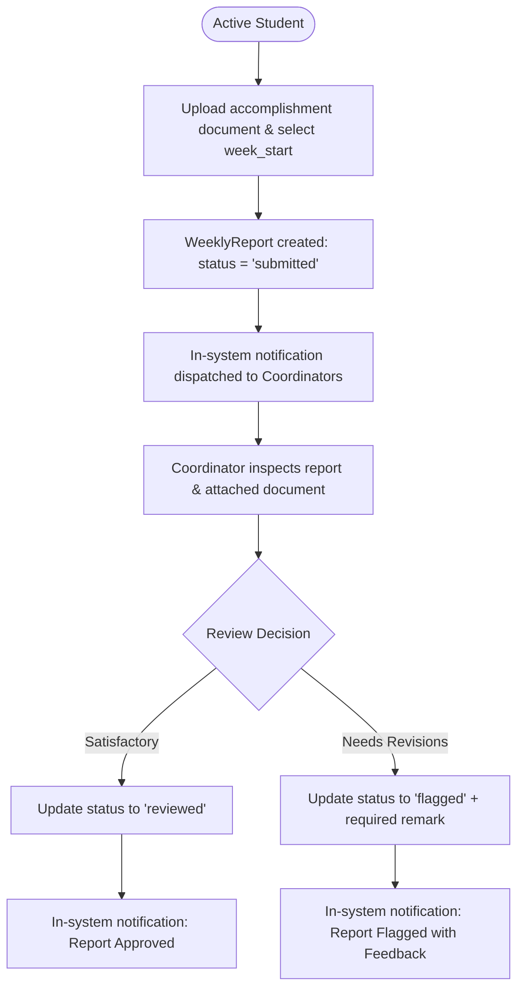

# F-016 Placement Monitoring & Weekly Accomplishment Reports

| Field | Value |
|---|---|
| Feature ID | F-016 |
| Module | Placements |
| Status | Done |
| Phase | 6 |
| Requirements | FR-16, NFR-01, NFR-03, NFR-04, NFR-06, NFR-07 |
| Business rules | BR-02, BR-05, BR-19 |
| Roles with access | Student (upload/submit weekly reports for active placement), OC / COC (inspect submissions, approve, flag with feedback remarks) |
| Owner (code) | `app/Http/Controllers/Student/StudentWeeklyReportController.php`, `app/Http/Controllers/Coordinator/WeeklyReportReviewController.php`, `app/Models/WeeklyReport.php` |

## 1. Purpose
Provides structured weekly progress and compliance monitoring for deployed ICS interns without requiring biometric attendance, daily time cards (DTR), or payroll processing (**Assumption A9**). Students submit weekly accomplishment reports with attached verified documents. Coordinators review submissions, approve satisfactory reports, or flag deficiencies with corrective feedback remarks.

## 2. Weekly Report Workflow

## 3. Screens
- `resources/views/student/placements/show.blade.php` (`/student/placements/{id}`):
  - Weekly report submission card: date picker (normalized to start of week), direct document upload input, and audit trail of previous submissions.
  - Status indicators (`Submitted`, `Reviewed`, `Flagged`) and coordinator feedback remarks.
- `resources/views/coordinator/placements/show.blade.php` (`/coordinator/placements/{id}`):
  - Central placement monitoring tab with historical report submissions.
  - Review modal for coordinators: one-click "Approve / Reviewed" or "Flag with Remark".

## 4. Routes
| Method | URI | Route name | Controller@action | Middleware / Policy |
|---|---|---|---|---|
| POST | `/student/placements/{placement}/weekly-reports` | `student.placements.weekly-reports.store` | `Student\StudentWeeklyReportController@store` | `auth`, `verified` |
| POST | `/coordinator/weekly-reports/{weeklyReport}/review` | `coordinator.weekly-reports.review` | `Coordinator\WeeklyReportReviewController@review` | `auth`, `role:oc,coc` |

## 5. Data & Schema
- Table `weekly_reports`:
  - `id` (bigint, PK)
  - `placement_id` (foreignId -> `placements`, cascadeOnDelete)
  - `week_start` (date)
  - `document_id` (foreignId -> `documents`, restrictOnDelete)
  - `status` (string enum: `submitted`, `reviewed`, `flagged`)
  - `reviewed_by` (foreignId -> `users`, nullable)
  - `remark` (text, nullable)
  - `timestamps`, `softDeletes`
  - Index: `(placement_id, week_start)`

## 6. Rules & Validation
- **Document-Only Monitoring (Assumption A9):**
  - ConnectEd strictly tracks accomplishment report submissions and supervisor endorsements. DTR clock-ins, biometric time records, and hourly stipend calculations are intentionally omitted to maintain focus on academic learning competencies.
- **Student Ownership & Placement Guard:**
  - Students can only submit weekly reports for their own active placement (`WeeklyReportPolicy::create`). Submissions for inactive or terminated placements are blocked.
- **Coordinator Review Validation:**
  - Marking a weekly report as `flagged` strictly requires a non-empty `remark` explaining the deficiency.
- **In-System Notifications (Rule BR-02):**
  - Coordinators receive in-system alerts when new reports are submitted. Students receive instant notification upon approval or flagging.

## 7. Testing
- `tests/Feature/Placements/WeeklyReportTest.php`:
  - `test_student_can_upload_and_submit_weekly_report`
  - `test_student_cannot_submit_report_for_another_students_placement`
  - `test_coordinator_can_approve_weekly_report`
  - `test_coordinator_flagging_weekly_report_requires_remark`
