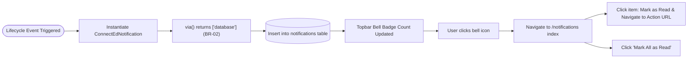

# F-017 In-System Notification Center

| Field | Value |
|---|---|
| Feature ID | F-017 |
| Module | Notifications |
| Status | Done |
| Phase | 6 |
| Requirements | FR-17, NFR-01, NFR-03, NFR-04, NFR-06, NFR-07 |
| Business rules | BR-02, BR-05 |
| Roles with access | All Roles (OC, COC, UA, PC, Student) |
| Owner (code) | `app/Notifications/ConnectEdNotification.php`, `app/Http/Controllers/NotificationController.php`, `resources/views/notifications/index.blade.php`, `resources/views/layouts/app.blade.php` |

## 1. Purpose
Provides an in-system notification hub across all user roles, ensuring real-time operational awareness for student registrations, company suggestions, legal reviews, opportunity approvals, application decisions, placement dual confirmations, and weekly report feedback. Strictly enforces **Rule BR-02 (In-System Notifications Only)** and **Rule BR-05 (No Outbound Email/SMS)**: all notifications are persisted to the database and displayed inside the application shell without external mail server dependencies.

## 2. Notification Dispatch Architecture

## 3. Screens
- `resources/views/layouts/app.blade.php` (Topbar Navigation Header):
  - Interactive notification bell icon with dynamic unread count badge.
  - Links directly to the notification center inbox (`/notifications`).
- `resources/views/notifications/index.blade.php` (`/notifications`):
  - Paginated notification stream categorized by state (All vs. Unread).
  - Visual notification type icons (Placement, Verification, Application, Report, Legal Note).
  - One-click actions: "Mark All as Read", individual read confirmation, and deep-link redirection to the relevant record (`action_url`).

## 4. Routes
| Method | URI | Route name | Controller@action | Middleware / Policy |
|---|---|---|---|---|
| GET | `/notifications` | `notifications.index` | `NotificationController@index` | `auth` |
| POST | `/notifications/{id}/read` | `notifications.read` | `NotificationController@markAsRead` | `auth` |
| POST | `/notifications/read-all` | `notifications.read-all` | `NotificationController@markAllAsRead` | `auth` |
| GET | `/notifications/unread-count` | `notifications.unread-count` | `NotificationController@unreadCount` | `auth` |

## 5. Data & Schema
- Table `notifications` (Laravel standard UUID notification table):
  - `id` (char(36), PK)
  - `type` (string)
  - `notifiable_type` (string, morphs)
  - `notifiable_id` (unsignedBigInteger, morphs)
  - `data` (text/json containing `title`, `body`, `action_url`, `type`)
  - `read_at` (timestamp, nullable)
  - `created_at`, `updated_at` (timestamps)
  - Indexes: `(notifiable_type, notifiable_id)`

## 6. Rules & Validation
- **Rule BR-02 & Rule BR-05 (In-System Only):**
  - `ConnectEdNotification::via()` strictly returns `['database']`.
  - No `mail`, `nexmo`, `pusher`, or external webhook channels are registered.
- **Deep-Link Auto-Redirection:**
  - Clicking an unread notification marks the notification as read in the database and automatically redirects the user to the associated contextual record (e.g., student application, placement review page, or MOA legal note queue).
- **Privacy & Role Scoping:**
  - Users can only view and mutate their own notification stream (`Auth::user()->notifications()`).

## 7. Testing
- `tests/Feature/Notifications/NotificationCenterTest.php`:
  - `test_rule_br02_notifications_use_database_channel_only`
  - `test_user_can_view_notifications_index`
  - `test_unread_count_json_endpoint`
  - `test_user_can_mark_notification_as_read_and_redirect_to_action_url`
  - `test_user_can_mark_all_notifications_as_read`
