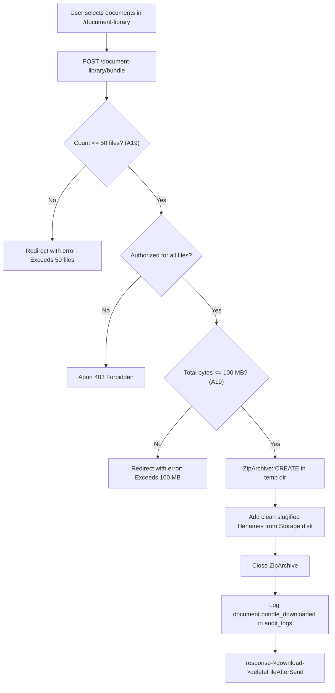

# F-020 Document Library, Completeness Matrix & ZIP Bundle Downloads

| Field | Value |
|---|---|
| Feature ID | F-020 |
| Module | Documents |
| Status | Done |
| Phase | 7 |
| Requirements | FR-20, NFR-01, NFR-03, NFR-04, NFR-06, NFR-07 |
| Business rules | BR-02, BR-15, Assumption A19 |
| Roles with access | OC (Full Access, Matrices, Bundles), COC (Cohort Scoped), UA (Legal Scoped), PC (Company Scoped), Student (Own Files + Templates) |
| Owner (code) | `app/Http/Controllers/DocumentLibraryController.php`, `resources/views/documents/library.blade.php`, `resources/views/documents/completeness.blade.php` |

## 1. Purpose
Provides a unified institutional document repository and compliance verification matrix:
- **Central Document Library:** Category-filtered document browser supporting Resumes, Company Verification Documents, MOA Executed Drafts & Scans, Weekly Reports, and University Templates.
- **Completeness Matrices:**
  - Student Compliance Matrix: Evaluates requirements across Resume, Consented Profile, and MOA execution.
  - Company Accreditation Matrix: Evaluates 6-point statutory checklist completion (SEC, Mayor's Permit, DTI, BIR 2303, PhilGEPS, Company Profile) and executed institutional agreements.
- **Batch ZIP Archive Bundle Download:** Enables authorized coordinators to select multiple documents and stream a compressed ZIP archive container with slugified naming, strictly adhering to batch safety limits (**Assumption A19: Max 50 files and 100 MB per batch**).

## 2. ZIP Archive Streaming Architecture

## 3. Screens
- `resources/views/documents/library.blade.php`:
  - Tabbed category navigation: All, Resumes, Company Verification, MOA Agreements, Weekly Reports, Templates.
  - Filters: Search original filename, Validation Status, Review Status, School Year.
  - Multi-select document checkboxes with floating download toolbar showing selected count.
  - Document metadata: File size, SHA-256 checksum preview, validation pill, review badge, upload timestamp, and uploader identity.
  - Direct download links for individual documents.
- `resources/views/documents/completeness.blade.php`:
  - Student Compliance Matrix: Cohort table showing Student Name, Student #, Resume status, Consent status, and MOA execution.
  - Company Accreditation Matrix: Industry partner enterprises table showing Classification, 6-Point Statutory Checklist completion (SEC, Mayor's Permit, DTI, BIR 2303, PhilGEPS, Profile), and Active MOA status.

## 4. Routes
| Method | URI | Route name | Controller@action | Middleware / Policy |
|---|---|---|---|---|
| GET | `/document-library` | `document-library.index` | `DocumentLibraryController@index` | `auth` |
| GET | `/document-library/completeness` | `document-library.completeness` | `DocumentLibraryController@completeness` | `auth`, role: OC/COC |
| POST | `/document-library/bundle` | `document-library.bundle` | `DocumentLibraryController@downloadBundle` | `auth` |

## 5. Rules & Business Logic
- **Role-Based Document Visibility:**
  - Coordinators (OC/COC) can view all student, company, MOA, weekly report, and template documents.
  - Students can strictly view only documents they own or uploaded, plus public institutional templates (`category = template`).
  - Partner companies can only view their own uploaded accreditation documents and agreements.
- **Assumption A19 (ZIP Bundle Constraints):**
  - Maximum of 50 files per single download batch.
  - Maximum total uncompressed size of 100 MB per batch.
  - If limits are exceeded, validation fails with user-friendly session errors.
- **Audit Logging (Rule BR-15):**
  - Every ZIP bundle generation is recorded in `audit_logs` with the action `document.bundle_downloaded`, capturing file count, byte size, and included document IDs.

## 6. Testing
- `tests/Feature/Documents/DocumentLibraryTest.php`:
  - `test_oc_can_view_all_documents_in_library`
  - `test_student_only_views_own_documents_and_templates`
  - `test_coordinator_can_view_completeness_matrix`
  - `test_student_cannot_access_completeness_matrix`
  - `test_authorized_user_can_download_zip_bundle_and_audit_is_recorded`
  - `test_bundle_download_enforces_50_files_limit`
